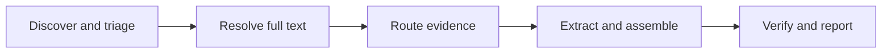

<div align="center">

# SkinMiner

### Evidence-aware literature mining for dermal drug formulation data

Turn measurements scattered across scientific text, tables, and figures into structured, policy-verified records with field-level provenance.

[](https://www.python.org/)
[](LICENSE)
[](LICENSE-DATA)
[](#project-status-and-scope)

🌐 **Language:** **English** · [简体中文](README.zh-CN.md)

[Quick start](#quick-start) · [Architecture](docs/architecture.md) · [Acceptance policies](docs/policies.md) · [Reproducibility](docs/reproducibility.md) · [Issues](https://github.com/yurbro/skinminer/issues)

</div>

> **Project status:** SkinMiner is active research software (`v0.1.0`) accompanying a manuscript in preparation. The results below are repository validation benchmarks and have not yet undergone peer review.

## Why SkinMiner?

Quantitative skin-permeation measurements—such as steady-state flux, permeability coefficients, cumulative amount permeated, and lag time—are essential for data-driven dermal formulation design. Yet the values, formulation compositions, and experimental conditions needed to interpret them are often split across prose, tables, and figures.

A single end-to-end LLM call can produce plausible structured output, but it does not reliably answer the questions that matter most for quantitative reuse:

- Does this record actually match the research scope?
- Is the numerical value attached to the correct formulation and endpoint?
- Where, exactly, did each field come from?
- Can the extraction and acceptance decisions be audited or reproduced?

SkinMiner addresses these questions with a modular, multimodal pipeline that separates discovery, routing, extraction, assembly, and scientific verification. It retains a record only when the record is supported by located evidence and satisfies an explicit acceptance policy.

## What makes it different

| Capability | SkinMiner approach |
|---|---|
| **Multimodal extraction** | Routes each study to text, table, figure, or mixed extractors instead of forcing every document through one prompt. |
| **One research specification** | Uses a versioned target definition to align literature retrieval with record-level acceptance. |
| **Evidence-grounded verification** | Separates extraction from the decision to verify, hold unresolved, or reject a record. |
| **Field-level provenance** | Preserves locators for source passages, table cells, and figure panels, plus reasons for failures and repairs. |
| **Typed, resumable execution** | Exchanges Pydantic records between stages and writes manifests and intermediate artifacts that support inspection and restart. |
| **Provider-neutral LLM layer** | Runs the same structured workflow with OpenAI or Anthropic models and supports stage-specific model selection. |
| **Decision-ready outputs** | Produces schema-aligned data for downstream modelling while retaining the metadata needed to judge whether datasets should be combined. |

## How it works



1. **Discover and triage** candidate studies from Europe PMC or a user-supplied document list.
2. **Resolve permitted content** with provenance, preferring structured XML or HTML before PDF where available.
3. **Route evidence** to text, table, figure, mixed, or unresolved paths.
4. **Extract and assemble** formulation, protocol, barrier, endpoint, and evidence fields into a shared schema.
5. **Verify and report** each candidate against cumulative scientific acceptance policies, preserving verified, unresolved, and rejected outcomes.

The detailed stage contracts are documented in [docs/architecture.md](docs/architecture.md). The current policy ladder is documented in [docs/policies.md](docs/policies.md).

## Output record

A canonical SkinMiner record can include:

- paper identity and DOI
- active substance and formulation composition
- IVPT/IVRT study type, diffusion device, membrane or skin barrier, and receptor conditions
- dose, diffusion area, endpoint type, value, unit, and time
- modality route and field-level evidence locators
- verification status, policy level, failure reasons, and deterministic repair history

This structure lets downstream users inspect both the extracted number and the basis for accepting it.

## Current validation snapshot

The bundled ibuprofen evaluation uses a manually annotated, 130-record gold standard containing 25 in-scope records. At the recommended Extended acceptance level, the current GPT configuration produced the following results:

| Evaluation question | Repository result |
|---|---:|
| Are retained records in scope? | **25/25 verified records; 100% scope precision** |
| Do retained values match the source? | **24/25; 96% end-to-end value accuracy** |
| Were sampled exclusions handled correctly? | **12/12 sampled rejections correct; 0/44 unresolved rows should have been retained** |
| Is there a stable result across repeated runs? | **24-record stable core across five runs; 13% CV in verified count** |
| What happens without modular verification? | Strongest single-pass baseline covered **24/25** gold records but emitted **288** raw records requiring further review |

These figures describe the released evaluation configuration, not performance on every drug, endpoint, or literature domain. Recompute the policy metrics with:

```bash
python -m evaluation.score_run \
  --gold-format round2 \
  --provider gpt \
  --policy-level v2 \
  --gold-csv evaluation/gold/gold_set_round2_annotation.csv
```

## Demonstrations

SkinMiner includes two reproducible demonstrations showing how verified literature records can be used after extraction.

### Demo 1 — literature-driven transfer modelling

Rebuilds the Watkinson formulation tables and evaluates whether records extracted from related cosolvent studies can support flux ranking and prediction. The reconstruction matches all 20 reported Table 4 cells at displayed precision and reproduces the reported few-shot analyses.

```bash
python demos/demo1/rebuild_demo1.py
```

### Demo 2 — should literature data be pooled with in-house experiments?

Tests Xiao-to-Bolla transfer and a mixing-ratio sweep before committing to pooled modelling. For the released pair, protocol mismatch and multivariate feature-space separation explain why literature augmentation does not reduce the required in-house experiments—a useful negative result that the extracted metadata makes diagnosable.

```bash
python demos/demo2/outputs/phase2_demo2_modelling/run_demo2_4feature.py
python demos/demo2/outputs/phase2_demo2_modelling/run_demo2_ratio_sweep.py
python demos/demo2/outputs/phase2_demo2_modelling/run_demo2_mechanism.py
```

See [docs/paper_mapping.md](docs/paper_mapping.md) for the full number-to-file trace and [docs/reproducibility.md](docs/reproducibility.md) for assumptions and version sensitivity.

## Quick start

### 1. Install

SkinMiner supports Python 3.11 and 3.12. Python 3.11 matches the validated reconstruction environment.

```bash
git clone https://github.com/yurbro/skinminer.git
cd skinminer
python -m venv .venv
```

Activate the environment:

```bash
# POSIX
source .venv/bin/activate

# Windows PowerShell
.venv\Scripts\Activate.ps1
```

Install the package:

```bash
python -m pip install --upgrade pip
python -m pip install -e .
```

Use the pinned environment when reproducing the released results:

```bash
python -m pip install -r requirements-lock.txt
```

### 2. Configure optional services

```bash
cp .env.example .env
```

Set `OPENAI_API_KEY` for OpenAI-backed stages and `UNPAYWALL_EMAIL` for Unpaywall access. Set `ANTHROPIC_API_KEY` only when selecting the Anthropic provider. Do not commit `.env`.

### 3. Run an offline smoke test

```bash
python -B -m evaluation.validate_gold_labels \
  --gold-jsonl evaluation/fixtures/gold_labels.small.jsonl
```

Expected output: `Validated gold-label entries: 1`. This command does not access the network or consume model tokens.

### 4. Explore the pipeline

```bash
python run_pipeline.py --list-run-profiles
python run_pipeline.py --list-query-profiles
python run_pipeline.py --help
```

Named run profiles include `budget_lean`, `text_table_baseline`, `balanced_full`, and `figure_deep`, allowing users to trade off cost, coverage, and figure processing explicitly.

## Repository guide

| Path | Purpose |
|---|---|
| `run_pipeline.py` | Main orchestration entry point |
| `corpus/`, `triage/`, `access/` | Literature discovery, screening, and permitted content resolution |
| `detection/`, `extractors/` | Modality routing and text/table/figure extraction |
| `assembly/`, `schemas/` | Canonical record construction and typed contracts |
| `policies/`, `verification/`, `patchers/` | Scientific scope checks, evidence adjudication, and auditable deterministic repairs |
| `evaluation/` | Gold-standard loaders, scoring, validation fixtures, and regression checks |
| `demos/` | Reproducible downstream modelling demonstrations |
| `results/`, `reports/` | Curated aggregate results and run-report builders |
| `docs/` | Architecture, policy, provenance, failure, and reproducibility documentation |

## Responsible release boundary

The public repository includes source code, a frozen bibliographic snapshot, a processed 130-record gold CSV, aggregate reports, figure inputs, and reproducible demonstrations. It excludes:

- source-paper PDFs whose redistribution rights vary by publisher
- source-derived page images, crops, masks, overlays, and mapping zooms
- record-level run archives containing extensive source-derived text
- raw third-party audit packages containing source-derived text or contact information

Aggregate artifacts required to inspect the reported metrics remain public. Requests for restricted research artifacts remain subject to copyright, privacy, and research-governance review.

## Project status and scope

SkinMiner is currently validated on an ibuprofen dermal-permeation use case. The architecture is designed to generalise, but performance has not yet been established across other active substances, additional endpoint families, supplementary materials, or all publisher formats. Contributions, bug reports, and reproducibility feedback are welcome through the [issue tracker](https://github.com/yurbro/skinminer/issues).

## Licensing

- Source code: [Apache License 2.0](LICENSE)
- Gold-standard data under `evaluation/`: [CC BY 4.0](LICENSE-DATA)
- Third-party bibliographic metadata and source-derived material: original source terms apply

The processed gold release records source licensing and provenance fields, and replaces non-permitted quotations with bibliographic and page/table/figure locators.

## Citation

Until the accompanying manuscript is submitted and its bibliographic details are fixed, cite the software repository:

```bibtex
@software{skinminer2026,
  author  = {Zhang, Yu and Wang, Xilu and Tsaoulidis, Dimitrios and Chen, Tao},
  title   = {SkinMiner: An LLM-powered data mining framework for dermal drug formulations},
  year    = {2026},
  version = {0.1.0},
  url     = {https://github.com/yurbro/skinminer}
}
```

## Acknowledgements

This work was jointly funded by the China Scholarship Council and the University of Surrey (Grant No. 202306440060).
