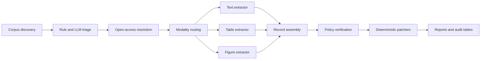

# Architecture

SkinMiner converts a broad bibliographic corpus into structured, policy-audited dermal formulation records. Each stage writes typed artifacts that can be inspected before the next stage runs.

## Data flow

```text
corpus → triage → access → routing → extractors → assembly → verification → patchers → reports
```



## Stage responsibilities

| Stage | Package | Responsibility | Principal artifacts |
|---|---|---|---|
| Corpus | `corpus/` | Build reproducible Europe PMC queries, normalize bibliographic metadata, and freeze corpus snapshots | corpus CSV and JSONL |
| Triage | `triage/` | Apply deterministic eligibility rules, then use an LLM only for ambiguous candidates | rule-pass, rule-fail, and LLM-triage decisions |
| Access | `access/` | Resolve Europe PMC, Unpaywall, HTML, XML, and PDF locations and record retrieval provenance | content-access records and source pointers |
| Routing | `detection/` | Detect whether relevant evidence is primarily text, table, figure, or mixed | route decisions and candidate locators |
| Extraction | `extractors/` | Parse text, structured tables, PDFs, and digitizable figures into typed candidate records | modality-specific records and evidence items |
| Assembly | `assembly/` | Merge compatible fragments, normalize endpoint representations, and retain provenance | canonical records |
| Verification | `verification/` and `policies/` | Apply acceptance policies, verify scientific scope, and adjudicate ambiguous records | verified, unresolved, and rejected records |
| Patching | `patchers/` | Apply explicit deterministic repairs for known endpoint, time, API, and route issues | patched records with audit metadata |
| Reporting | `reports/` | Aggregate run metrics, blockage reasons, model usage, and paper-facing summaries | run reports and aggregate CSV files |

## Typed contracts

`schemas/models.py` defines the shared Pydantic models. The core `Record` object contains paper identity, formulation, study type, device, barrier, conditions, endpoints, evidence items, provenance, verification status, and failure reason. Extractors exchange typed models rather than loosely structured dictionaries.

`evaluation/models.py` contains evaluation contracts. `evaluation/round2_gold.py` adapts the released Round-2 CSV into cumulative policy scores without altering the source annotations.

## Routing and extraction

The router can select more than one modality for a paper. Text extraction targets statements and nearby context. Table extraction preserves row and column structure and emits one formulation by endpoint record where possible. Figure extraction identifies candidate panels, digitizes curves, and converts image coordinates to endpoint values when axes can be calibrated.

Mixed-route records retain provenance from each contributing modality. Assembly prefers explicit structured values and keeps evidence locators so verification can identify conflicts.

## Verification and patching

Verification separates scope decisions from extraction. A syntactically valid record can still fail because it uses the wrong active ingredient, concentration basis, device, study type, endpoint, or time point. The four policy levels are cumulative and are documented in [policies.md](policies.md).

Patchers implement narrow, reviewable corrections. They do not silently overwrite evidence. Patched fields retain a reason and provenance entry.

## Execution and resumability

`run_pipeline.py` is the orchestration entry point. Stage outputs allow a run to resume after interruption. The public `.gitignore` excludes `.resume/` and generated `outputs/` because run workspaces may contain copyrighted source text and record-level evidence.

## Published data boundary

The repository includes source code, a frozen bibliographic corpus, the processed 130-row gold CSV, aggregate reports, paper-figure inputs, and two reproducible demos. It excludes source PDFs, remote page caches, record-level run JSONL, and the raw Claude audit package. See [paper_mapping.md](paper_mapping.md) for the exact public source of each manuscript result.

